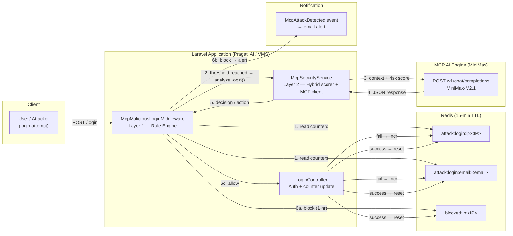
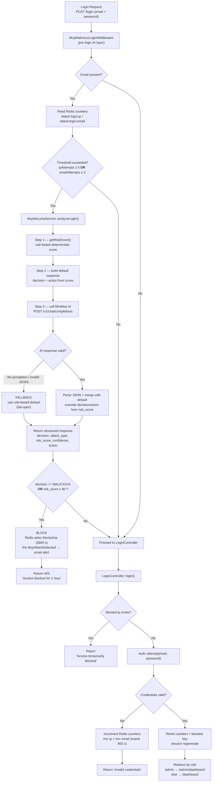
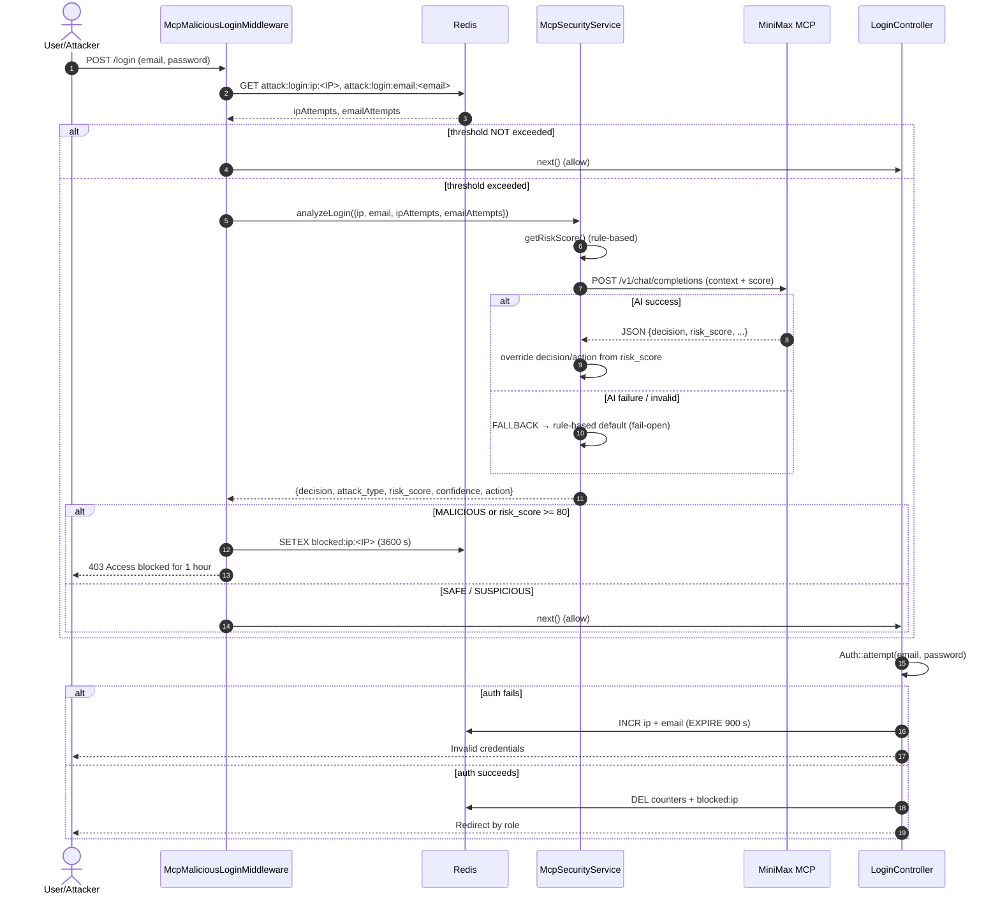

# System Architecture & Algorithm Flow
### Adaptive AI-Based Login Intrusion Detection (MCP + Rule Engine)

> **Source of truth (actual code):**
> - `app/Http/Middleware/McpMaliciousLoginMiddleware.php`
> - `app/Services/McpSecurityService.php`
> - `app/Http/Controllers/Auth/LoginController.php`
> - `app/Events/McpAttackDetected.php` / `app/Services/SecurityEmailService.php`

---

## Figure 1 — High-Level System Architecture



---

## Figure 2 — Algorithm Flowchart (Detailed)



---

## Figure 3 — Sequence Diagram (Request Lifecycle)



---

## Step-by-Step Explanation

1. **Interception** — `McpMaliciousLoginMiddleware` intercepts every `POST /login` **before** the controller runs. It extracts the client `IP` and submitted `email`.

2. **Redis counter read** — The middleware reads two counters (`attack:login:ip:<IP>`, `attack:login:email:<email>`). These counters hold the number of **prior failed attempts** (incremented by the controller on each failure, with a 15-minute TTL).

3. **Threshold gate (Rule Engine, Layer 1)** — MCP/AI analysis is invoked **only when** `ipAttempts >= 5` **OR** `emailAttempts >= 3`. Below the threshold, the request flows straight to the normal auth path (this keeps API cost low and avoids latency for ordinary users).

4. **Hybrid scoring (Layer 2)** — `McpSecurityService::analyzeLogin()`:
   - **(a)** computes a deterministic `risk_score` via `getRiskScore()`,
   - **(b)** builds a **default** response from that score,
   - **(c)** calls the MiniMax MCP model with the context (`ip`, `email`, `ip_attempts`, `email_attempts`, 15-min window),
   - **(d)** on success, merges the AI JSON with the default and **re-derives `decision` and `recommended_action` from the numeric `risk_score`** (the AI's own decision text is overridden).

5. **Fallback (fail-open)** — If the AI call throws an exception or returns invalid JSON, the system returns the **rule-based default** instead of crashing or blocking the user. This guarantees availability even when the MCP endpoint is down.

6. **Blocking decision** — The middleware blocks **only if** `decision == MALICIOUS` **OR** `risk_score >= 80`. On block: it writes `blocked:ip:<IP>` (1-hour TTL), fires `McpAttackDetected` (which triggers an email alert to the security admin), and returns HTTP `403`.

7. **Normal auth path** — `LoginController::login()` re-checks the `blocked:ip` key (defense-in-depth), then calls `Auth::attempt()`:
   - **fail** → increments both Redis counters (15-min TTL) and returns "Invalid credentials",
   - **success** → clears the counters and the block key, regenerates the session, and redirects by role.

---

## Decision / Action Reference (from code)

| Risk Score | Decision | attack_type | Recommended Action |
|---|---|---|---|
| 0 – 29 | `SAFE` | normal_user | `monitor` |
| 30 – 49 | `SAFE` | normal_user | `captcha` |
| 50 – 79 | `SUSPICIOUS` | credential_stuffing | `otp` |
| 80 – 100 | `MALICIOUS` | brute_force | `block_ip` |

> **Note for the paper:** the AI prompt only asks for a binary `SAFE`/`MALICIOUS`, but the system introduces a third tier `SUSPICIOUS` when overriding the decision from `risk_score` (50–79).

---

## How to export for the paper

Render the Mermaid diagrams to PNG/SVG with `mermaid-cli`:

```bash
npx @mermaid-js/mermaid-cli -i "System Architecture Algorithm Flow.md" -o figures/architecture.png
```

Each ```` ```mermaid ```` block can also be pasted into [mermaid.live](https://mermaid.live) and exported as SVG/PNG (300 DPI recommended for print).
